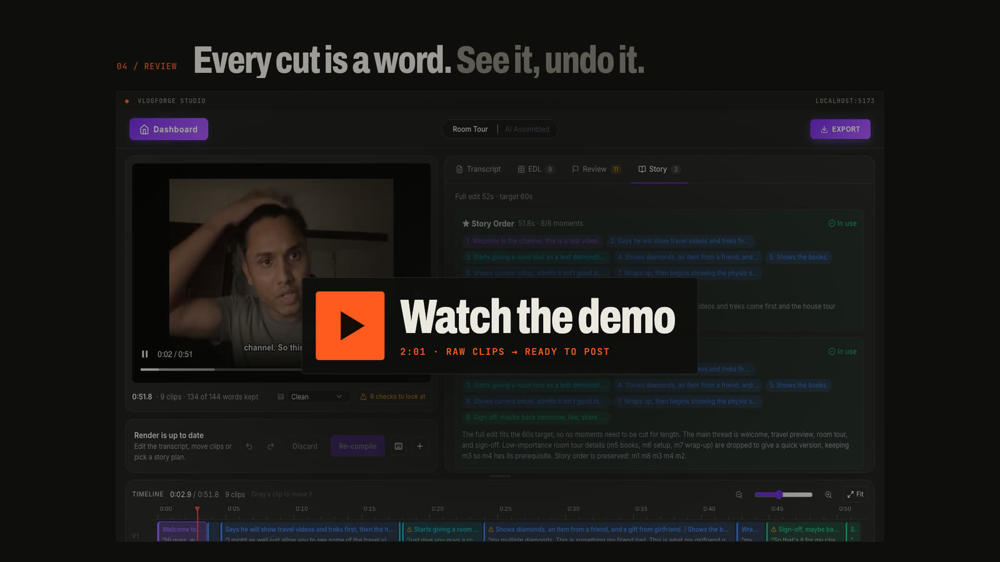
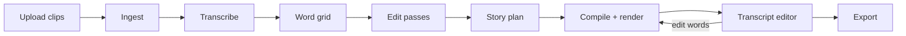

# VlogForge 🎬

VlogForge turns raw talking-to-camera footage into a first-cut vlog. Upload your clips. It transcribes every word, removes dead air, stutters, fillers, retakes and false starts, puts the story in order to fit a target length, and renders the edit. You then review the cut as a transcript: click words to keep or remove them, re-render in seconds, and export in any frame shape with burned-in captions.

A **FastAPI** backend runs the pipeline. A **React + Vite** frontend handles upload, progress, the transcript editor and export.

[](media/demo.mp4)

**[▶ Watch the demo](media/demo.mp4)** (2 min): four raw phone clips of a room tour, recorded out of order, go through the app: upload, processing, the transcript editor, export. VlogForge cuts the stutters, a filler and a false start, shortens long pauses, puts the clips in story order and burns in captions. The finished cut plays in full at the end, with no manual edits.

**Status:** working MVP that runs on your own machine. It is not hosted: every job runs Whisper and WhisperX locally and makes paid Claude calls, so a public instance would need a GPU and per-user billing. B-roll over voice-over is built and measured but switched off for now.

---

## How it works



1. **Ingest**: makes a light proxy and extracts audio for each clip (in parallel). Audio-only files (voice-over) are accepted.
2. **Transcribe**: local `faster-whisper` (turbo), then WhisperX forced alignment for accurate word times. Speech the first pass skipped is re-transcribed and merged back in.
3. **Word grid**: every word gets a stable ID and a time that has been checked against the audio. All edits refer to these word IDs, so a cut never lands inside a word.
4. **Edit passes** (Claude): sequential passes, each reading the previous pass's edit. They remove dead gaps, stutters and fillers, and repeated takes (keeping the cleanest), then incomplete lines, self-corrections and redo cues, and finish with a final review. Code-level guarantees: no line is kept twice, and no phrase repeats back to back.
5. **Story plan** (Claude): splits the edit into moments (story beats), orders them by the stated plan and real recording time, and drops the least important ones to fit the target duration.
6. **Compile + render**: deterministic, frame-accurate cuts in the pauses between words. Long pauses are shortened to the speaker's own rhythm, loudness is normalised, and the render is validated (A/V length, no clipped words).
7. **Review + export**: the transcript editor re-compiles only the render step. Export options:
   - layouts: 16:9, 9:16, 1:1, 4:5
   - caption styles: Clean, Bold, Boxed, Cinema
   - edit lists for other editors: CMX3600 EDL and FCPXML
   - AI-written post copy: a YouTube title, description and chapters, or Reels/Shorts captions with hashtags

B-roll over voice-over is built but switched off for the MVP (`ENABLE_BROLL=false`).

---

## Design choices

- **Words are the edit unit.** The LLM never writes timestamps. It returns word IDs to keep or cut, and the compiler turns them into cuts placed in the pauses between words. A model mistake can drop a word, but it cannot cut one in half.
- **The LLM judges, code guarantees.** Prompts decide what is a stutter or a weaker take. Hard rules in code enforce what must never happen: a line kept twice, a phrase repeated back to back, a render whose audio and video lengths differ.
- **Small passes, one job each.** Each edit pass reads the edit left by the one before. Word-level stutter and filler cuts use Claude Haiku. Choosing between takes, incomplete lines and the final review use Claude Sonnet.
- **Keep by default.** Unique speech stays even when it is imperfect. Only redundant speech is cut, so a noisy daily vlog with no retakes loses nothing it needs.
- **Deterministic render, cached stages.** The same plan always gives the same cut. Stage results are stored by content, so editing words in the transcript re-runs only the render (seconds, not minutes), and an unchanged clip is never transcribed twice.

## How it's measured

`backend/eval/` scores the pipeline against hand-labelled answer keys on a varied set of real clips: talking-head footage full of retakes, a noisy mixed-language daily vlog, and multi-file shoots. The footage and answer keys are private, so the scripts are in the repo but need a local eval set to run.

- **Speech edit** (`edit_passes_eval.py`): cut recall and over-cut in words against a human edit of the same footage. Dropping unique speech must be zero.
- **Transcript** (`grid_eval.py`, `asr_bakeoff.py`): word-boundary error and speech left uncovered by words. The ASR setup was picked by a bake-off of local and hosted models, which is how missed-speech re-transcription got added.
- **Render** (`join_audio.py`): level jumps in speech and background at every cut.
- **B-roll** (`broll_eval.py`, `footage_eval.py`): where cutaways go and which shot is chosen, scored against the editors of finished vlogs.

---

## Getting started

### Prerequisites
- Conda (Miniconda or Anaconda): the environment includes Python 3.11 and FFmpeg
- Node.js 18+
- Docker (for Postgres), or any Postgres 15 you point `DATABASE_URL` at
- An Anthropic API key

### 1. Configure

```bash
cp .env.example .env        # repo root; fill in CLAUDE_API_KEY and JWT_SECRET_KEY
```

### 2. Database

```bash
docker compose up -d        # Postgres on localhost:5432 (credentials match .env.example)
```

### 3. Backend

```bash
conda env create -f environment.yml
conda activate vlogforge
cd backend
alembic upgrade head        # create the tables
uvicorn app.main:app --reload --port 8000
```

The first job downloads the Whisper and WhisperX models, which takes a few minutes once.

### 4. Frontend

```bash
cd frontend
npm install
npm run dev                 # http://localhost:5173 (proxies /api and /ws to :8000)
```

Register an account, create a project, add footage, pick a target length and click **Generate Vlog**.

---

## Repository layout

```
backend/
  app/
    main.py              API routes + progress WebSocket
    routers/             auth, projects, resumable (tus) upload
    tasks/
      orchestrator.py    runs the pipeline stages above
      ingest.py, transcribe.py, asr_recovery.py, word_grid.py
      edit_passes.py     LLM edit passes -> EditPlan
      moments.py, storyplan.py
      compiler.py, validate.py, recompile.py
      subtitles.py, layouts.py, review_export.py, publish_copy.py
      broll.py, footage.py, shots.py   (B-roll, off in the MVP)
    utils/               ffmpeg, speech activity, artifact store, Claude client
  tests/                 pytest suite (hermetic; a few tests need ffmpeg on PATH)
  eval/                  measurement scripts; they need a local eval set that is not in the repo
frontend/src/            React app (TranscriptEditor, PublishPanel, EditTimeline, ...)
```

Run the tests from `backend/` with the conda env active:

```bash
python -m pytest -q
```

## Storage

- `uploads/<project_id>/`: raw uploads, proxies and audio
- `outputs/`: rendered MP4s
- `artifacts/`: stored stage results (transcripts, edits, moments), so a job can be re-compiled after a restart and an unchanged clip is never transcribed twice
- `logs/`: per-job and interaction logs

All four are git-ignored.

## License

[MIT](LICENSE)
