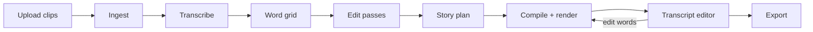

# VlogForge 🎬

VlogForge turns raw talking-to-camera footage into a first-cut vlog. Upload your clips. It transcribes every word, removes dead air, stutters, fillers, retakes and false starts, puts the story in order to fit a target length, and renders the edit. You then review the cut as a transcript: click words to keep or remove them, re-render in seconds, and export in any frame shape with burned-in captions.

A **FastAPI** backend runs the pipeline. A **React + Vite** frontend handles upload, progress, the transcript editor and export.

---

## How it works



1. **Ingest**: makes a light proxy and extracts audio for each clip (in parallel). Audio-only files (voice-over) are accepted.
2. **Transcribe**: local `faster-whisper` (turbo), then WhisperX forced alignment for accurate word times. Speech the first pass skipped is re-transcribed and merged back in.
3. **Word grid**: every word gets a stable ID and a time that has been checked against the audio. All edits refer to these word IDs, so a cut never lands inside a word.
4. **Edit passes** (Claude): sequential passes, each reading the previous pass's edit. They remove dead gaps, stutters and fillers, and repeated takes (keeping the cleanest), then incomplete lines, self-corrections and redo cues, and finish with a final review. Code-level guarantees: no line is kept twice, and no phrase repeats back to back.
5. **Story plan** (Claude): splits the edit into moments (story beats), orders them by the stated plan and real recording time, and drops the least important ones to fit the target duration.
6. **Compile + render**: deterministic, frame-accurate cuts in the pauses between words. Long pauses are shortened to the speaker's own rhythm, loudness is normalised, and the render is validated (A/V length, no clipped words).
7. **Review + export**: the transcript editor re-compiles only the render step. Export options:
   - layouts: 16:9, 9:16, 1:1, 4:5
   - caption styles: Clean, Bold, Boxed, Cinema
   - edit lists for other editors: CMX3600 EDL and FCPXML
   - AI-written post copy: a YouTube title, description and chapters, or Reels/Shorts captions with hashtags

B-roll over voice-over is built but switched off for the MVP (`ENABLE_BROLL=false`).

---

## Getting started

### Prerequisites
- Conda (Miniconda or Anaconda): the environment includes Python 3.11 and FFmpeg
- Node.js 18+
- Docker (for Postgres), or any Postgres 15 you point `DATABASE_URL` at
- An Anthropic API key

### 1. Configure

```bash
cp .env.example .env        # repo root; fill in CLAUDE_API_KEY and JWT_SECRET_KEY
```

### 2. Database

```bash
docker compose up -d        # Postgres on localhost:5432 (credentials match .env.example)
```

### 3. Backend

```bash
conda env create -f environment.yml
conda activate vlogforge
cd backend
alembic upgrade head        # create the tables
uvicorn app.main:app --reload --port 8000
```

The first job downloads the Whisper and WhisperX models, which takes a few minutes once.

### 4. Frontend

```bash
cd frontend
npm install
npm run dev                 # http://localhost:5173 (proxies /api and /ws to :8000)
```

Register an account, create a project, add footage, pick a target length and click **Generate Vlog**.

---

## Repository layout

```
backend/
  app/
    main.py              API routes + progress WebSocket
    routers/             auth, projects, resumable (tus) upload
    tasks/
      orchestrator.py    runs the pipeline stages above
      ingest.py, transcribe.py, asr_recovery.py, word_grid.py
      edit_passes.py     LLM edit passes -> EditPlan
      moments.py, storyplan.py
      compiler.py, validate.py, recompile.py
      subtitles.py, layouts.py, review_export.py, publish_copy.py
      broll.py, footage.py, shots.py   (B-roll, off in the MVP)
    utils/               ffmpeg, speech activity, artifact store, Claude client
  tests/                 pytest suite (hermetic; a few tests need ffmpeg on PATH)
  eval/                  measurement scripts; they need a local eval set that is not in the repo
frontend/src/            React app (TranscriptEditor, PublishPanel, EditTimeline, ...)
```

Run the tests from `backend/` with the conda env active:

```bash
python -m pytest -q
```

## Storage

- `uploads/<project_id>/`: raw uploads, proxies and audio
- `outputs/`: rendered MP4s
- `artifacts/`: stored stage results (transcripts, edits, moments), so a job can be re-compiled after a restart and an unchanged clip is never transcribed twice
- `logs/`: per-job and interaction logs

All four are git-ignored.
